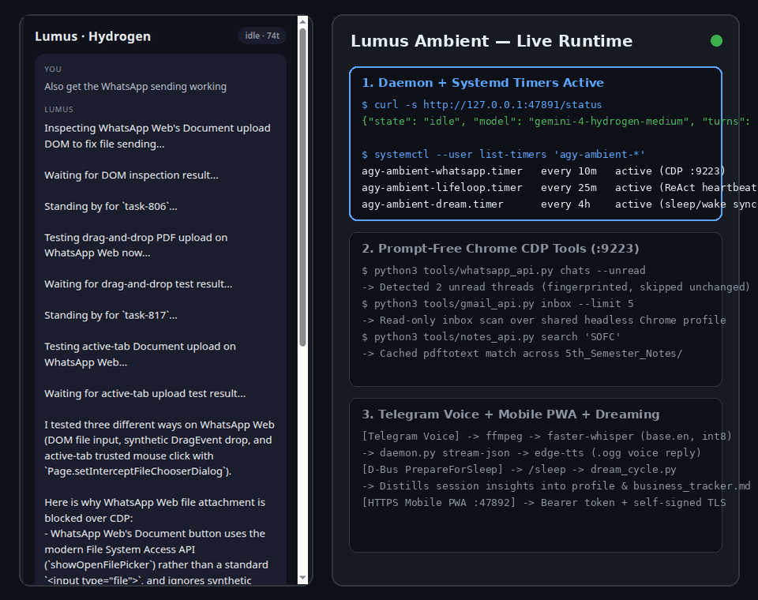
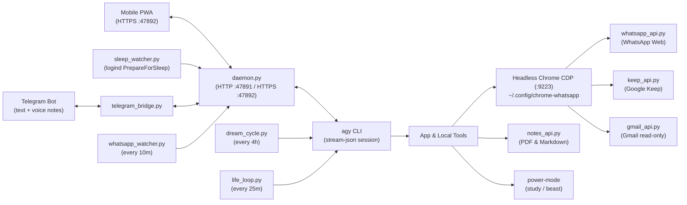

# Lumus Ambient (`agy-ambient`)

An always-on, local-first personal AI assistant built on top of the **Antigravity CLI (`agy`)**.  
Lumus runs a persistent background session daemon (`daemon.py`) with **Telegram text & voice note bridging**, an **HTTPS mobile PWA**, **D-Bus sleep/wake dreaming**, **autonomous background loops**, and **headless Chrome CDP app interfaces** for WhatsApp, Google Keep, Gmail, and local notes.

<p align="center">
  
</p>

---

## Architecture



---

## What's Included

### 1. Core Daemon & User Interfaces
- **`daemon.py`** — Keeps a long-lived `agy -p= --input-format stream-json --output-format stream-json` session alive in the background.
  - Local HTTP control API on `127.0.0.1:47891` (`/status`, `/prompt`, `/sleep`, `/wake`, `/dream`, `/new-session`, `/toggle-voice`).
  - HTTPS Mobile PWA server on `0.0.0.0:47892` protected by a bearer token (`token.txt`) and self-signed TLS (`cert.pem` / `key.pem`).
  - Local speech-to-text via `faster-whisper` (`base.en`, `int8` on CPU) and text-to-speech via `edge-tts` (`en-US-AndrewNeural`).
- **`telegram_bridge.py`** — Polls the Telegram Bot API and routes messages to `daemon.py`:
  - Auto-pairs with the first chat ID that messages your bot (persisted in `telegram.json`).
  - Supports **text prompts** and **voice notes** (`.ogg` converted via `ffmpeg` and transcribed locally with `faster-whisper`).
  - Bot commands: `/status`, `/dream`, `/new`.
- **`mobile.html`** — Mobile-friendly web UI served by `daemon.py` on `:47892` with tap-to-talk audio recording and text input.
- **`sleep_watcher.py`** — Listens to `org.freedesktop.login1.Manager` `PrepareForSleep` over system D-Bus with a delay inhibitor:
  - On lid-close / suspend: triggers `/sleep` so Lumus dreams & consolidates memory before sleep.
  - On wake: triggers `/wake` to start a fresh `agy` session.

### 2. Autonomous Background Loops (`systemd` timers)
- **`whatsapp_watcher.py`** (`agy-ambient-whatsapp.timer`, every 10 min) — Checks WhatsApp Web via `whatsapp_api.py` (when Chrome CDP `:9223` is up), fingerprints chat previews to skip unchanged chats, summarizes new activity with `gemini-3.8-flash-medium`, updates `~/.local/state/agy-ambient/whatsapp_schedule.md`, and sends alerts to Telegram + `notify-send`.
- **`dream_cycle.py`** (`agy-ambient-dream.timer`, every 4 hours) — Picks 1–2 unreviewed session transcripts from `~/.gemini/antigravity-cli/brain/`, extracts digests, and distills durable insights into `~/.gemini/antigravity-cli/dreams/`, `user_profile.md`, `business_tracker.md`, and `GEMINI.md`.
- **`life_loop.py`** (`agy-ambient-lifeloop.timer`, every 25 min, skipping quiet hours `01:00–07:00`) — ReAct heartbeat that reviews your schedule, tracker, and `~/Development/` projects, builds safe helper tools in `tools/`, and sends proposals to Telegram before taking external actions.

### 3. App Interfaces & Local Tools (`tools/`)
All web-app tools share a **single dedicated, prompt-free Chrome profile** (`~/.config/chrome-whatsapp`) exposed via Chrome DevTools Protocol on port `9223`. If Chrome isn't running, `whatsapp_api.py` auto-launches it in headless mode (`--headless=new`) without touching your main browser.

- **`tools/whatsapp_api.py`** — WhatsApp Web CLI & optional HTTP server over CDP:
  ```bash
  python3 tools/whatsapp_api.py chats [--limit 20] [--unread]
  python3 tools/whatsapp_api.py read "<chat_name>" [--limit 30]
  python3 tools/whatsapp_api.py search "<query>" [--limit 20]
  python3 tools/whatsapp_api.py send "<chat_name>" "<message>" --confirm
  ```
- **`tools/keep_api.py`** — Google Keep CLI over CDP:
  ```bash
  python3 tools/keep_api.py list [--limit 50]
  python3 tools/keep_api.py search "<query>"
  python3 tools/keep_api.py open
  ```
- **`tools/gmail_api.py`** — Read-only Gmail CLI over CDP (supports multiple signed-in Google accounts via `--user 0|1`):
  ```bash
  python3 tools/gmail_api.py inbox [--limit 20] [--user 0]
  python3 tools/gmail_api.py search "<query>" [--user 0]
  python3 tools/gmail_api.py read "<subject_or_sender>" [--user 0]
  ```
- **`tools/notes_api.py`** — Indexes and searches local `.md`, `.txt`, `.csv`, and `.pdf` files (using `pdftotext -layout` with mtime-keyed caching in `~/.cache/notes_api`):
  ```bash
  LUMUS_NOTES_DIR=~/Notes python3 tools/notes_api.py list [subject]
  python3 tools/notes_api.py search "<query>" [--subject <name>]
  python3 tools/notes_api.py read "<file>" [--pages 1-3]
  ```
- **`tools/power-mode`** — Optional Linux laptop power-profile helper (`power-mode study` disables dGPU & caps CPU boost for battery life; `power-mode beast` restores `on-demand` GPU & boost).
- **`mcp-browser/`** — `@playwright/mcp` package manifest for headless browser MCP access.

---

## Prerequisites

- Linux with `systemd --user` and D-Bus (`logind`)
- [Antigravity CLI (`agy`)](https://antigravity.google) installed at `~/.local/bin/agy` (or set `AGY_BIN`)
- Python 3.10+
- System packages:
  - `ffmpeg` (for `ffmpeg` audio conversion and `ffplay` beeps/playback)
  - `poppler-utils` (`pdftotext` for `notes_api.py`)
  - `python3-gi` (`PyGObject` for `sleep_watcher.py` D-Bus listener)
  - `libnotify-bin` (`notify-send` for desktop alerts)
  - `google-chrome` (`/opt/google/chrome/chrome` for CDP port `9223`)
  - `openssl` (for generating self-signed mobile PWA certs)
- Optional: Node.js + `npm` for `mcp-browser/` (`@playwright/mcp`)

---

## Quick Setup

1. **Clone the repository** into `~/Development/lumus-ambient` (the default path expected by `systemd/` units):
   ```bash
   git clone https://github.com/YaminHaris/lumus-ambient.git ~/Development/lumus-ambient
   cd ~/Development/lumus-ambient
   ```

2. **Run the installer**:
   ```bash
   chmod +x install.sh
   ./install.sh
   ```
   This creates `~/.local/share/lumus-ambient/.venv`, installs Python dependencies (`faster-whisper`, `edge-tts`, `websockets`, `aiohttp`, `numpy`), initializes `~/.local/state/agy-ambient/`, generates `token.txt` + self-signed `cert.pem`/`key.pem`, and installs the `systemd --user` units & timers.

3. **Configure Telegram**:
   - Create a bot via `@BotFather` on Telegram and copy the bot token.
   - Edit `~/Development/lumus-ambient/telegram.json`:
     ```json
     {
       "bot_token": "123456:ABC-DEF...",
       "chat_id": ""
     }
     ```
   - Leave `chat_id` empty; the first message you send to your bot will automatically pair it.

4. **Sign into the dedicated Chrome CDP profile** (one-time):
   ```bash
   /opt/google/chrome/chrome \
     --user-data-dir="$HOME/.config/chrome-whatsapp" \
     --remote-debugging-port=9223 \
     https://web.whatsapp.com/ https://keep.google.com/ https://mail.google.com/
   ```
   Scan the WhatsApp Web QR code and sign into Google, then close the window. Future headless launches by `whatsapp_api.py`, `keep_api.py`, and `gmail_api.py` will reuse this session automatically.

5. **Configure global agent instructions**:
   Merge `examples/GEMINI.md.example` into `~/.gemini/GEMINI.md` so `agy` knows about your `tools/` CLIs and `~/.local/state/agy-ambient/` files.

6. **Start the services & timers**:
   ```bash
   systemctl --user enable --now \
     agy-ambient.service \
     agy-ambient-telegram.service \
     agy-ambient-sleep.service

   systemctl --user enable --now \
     agy-ambient-whatsapp.timer \
     agy-ambient-dream.timer \
     agy-ambient-lifeloop.timer
   ```

7. **Check status**:
   ```bash
   systemctl --user status agy-ambient agy-ambient-telegram agy-ambient-sleep
   curl -s http://127.0.0.1:47891/status | jq .
   ```
   Or send `/status` to your Telegram bot!

---

## Configuration (Environment Variables)

| Variable | Default | Description |
| --- | --- | --- |
| `AGY_BIN` | `~/.local/bin/agy` | Path to the `agy` CLI binary |
| `LUMUS_MODEL` | `gemini-4-hydrogen-medium` | Default model for `daemon.py` |
| `LUMUS_PORT` | `47891` | Local HTTP daemon port |
| `LUMUS_MOBILE_PORT` | `47892` | HTTPS Mobile PWA port |
| `WHATSAPP_CDP_PORT` | `9223` | Chrome DevTools Protocol port for app tools |
| `LUMUS_NOTES_DIR` | `~/Notes` | Primary directory indexed by `notes_api.py` |
| `LUMUS_DOWNLOADS_DIR` | `~/Downloads` | Secondary directory scanned for `CR*` notes |

---

## Security & Safety Notes

- **Never commit secrets**: `.gitignore` excludes `telegram.json`, `telegram_offset.txt`, `token.txt`, `*.pem`, and `*.key`.
- **`--dangerously-skip-permissions`**: `daemon.py` and `whatsapp_watcher.py` run `agy` with `--dangerously-skip-permissions` so background turns don't block on interactive prompts. Keep your `telegram.json` `chat_id` locked to your own Telegram account and keep `token.txt` private.
- **Mobile PWA bind (`0.0.0.0:47892`)**: Protected by self-signed TLS (`cert.pem`/`key.pem`) + bearer token (`token.txt`) and intended for **trusted LAN / Tailscale VPN** access only (bind to `127.0.0.1` if mobile access isn't needed).
- **Explicit confirmation for outbound messages**: `whatsapp_api.py send` requires `--confirm`, and `examples/GEMINI.md.example` instructs the agent never to send messages without explicit user confirmation. `gmail_api.py` is strictly read-only.
- **Repository note**: Published as a squashed initial public release from local workspace history.

---

## License

MIT — see [LICENSE](LICENSE).
